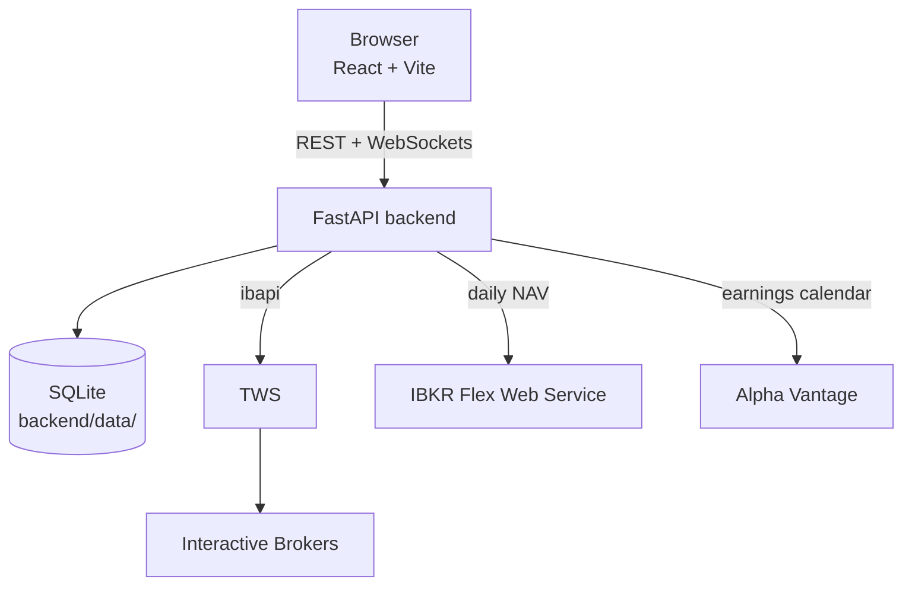

# Investor OS

Investor OS is an investment and trading dashboard for Interactive Brokers. It combines live portfolio monitoring, portfolio risk analysis, US equity options analysis, options screening, order management, trade journaling, valuation modeling, stock ranking, earnings tracking, and day-trading notes.

It is intended for personal use and does not currently provide alerts, non-US options support, authentication, or a hosted deployment configuration.

## Features

- **Portfolio** - Monitor IBKR account summaries, positions, market prices, and P&L. View saved daily net account value (NAV) with date ranges and an editable monthly **Amount invested** history. Cached history remains available when TWS is offline.
- **Portfolio Analysis** - See the account's option-adjusted, beta-weighted exposure, Greeks, assignment exposure, margin headroom, a stress grid with an estimated distance to margin call, user-set risk limits, realised volatility and drawdown, and a daily risk history. Read-only.
- **Options** - Analyze US equity tickers with daily candles, Bollinger Bands, RSI, expirations, and live option chains. Bid/ask selections can build stock or multi-leg option order tickets.
- **CSP, CC, and CS Screeners** - Scan saved ticker lists for cash-secured puts, covered calls, and put/call credit spreads. Shared features include durable filters, live scan progress, warnings, quote refresh, and option-ticket hand-off; CS also supports configurable spread widths and two-leg mapping.
- **Orders** - Preview and transmit whole-share stock orders or option strategies. Track active and current-day terminal orders, reconcile IBKR state, amend supported orders, and cancel active orders.
- **Options Trade Tracker** - Create named tracker workspaces, record trades and notes, and review calculated P&L, totals, monthly performance, and strategy execution statistics.
- **Day Trading Tracker** - Maintain month-based daily trade rows and review day-trading P&L/statistics.
- **Stock Analysis** - Build and autosave five-year bull, base, and bear valuation scenarios for individual tickers, including current-price lookup and multiple valuation methods.
- **Rank Stocks** - Rank saved Stock Analysis models across bull, base, and bear scenarios using P/S, P/E, P/EBITDA, P/OCF, and P/FCF methods.
- **Earnings Watch** - Maintain a global ticker watchlist, fetch upcoming earnings dates, mark rows reviewed, and preserve last-known dates when a refresh is unavailable.

## Architecture



The frontend is a single-page React application with sidebar navigation and no URL routing. The backend exposes REST and WebSocket APIs from `backend/app/main.py`, keeps one Interactive Brokers client connection in a background thread, and composes feature-specific services and routers.

User-entered state is persisted in SQLite databases under `backend/data/`. Options screener scan jobs, progress, and completed result snapshots are held in memory and lost on backend restart; ticker lists and filters are durable.

## Tech stack

### Backend

- Python 3.12+
- FastAPI and Uvicorn
- Interactive Brokers `ibapi`
- Pydantic 2
- `httpx` for Alpha Vantage and IBKR Flex HTTP calls
- SQLite via Python's standard `sqlite3` module
- `uv` for dependency and environment management
- Pytest for automated tests

### Frontend

- React 19
- TypeScript
- Vite
- Tailwind CSS 4
- shadcn/ui and Radix UI primitives
- TradingView Lightweight Charts for market/indicator charts
- Recharts for portfolio and tracker statistics
- `pnpm` for package management
- Vitest and Testing Library for automated tests

## Prerequisites

Install the following before starting:

- Python 3.12 or newer
- [`uv`](https://docs.astral.sh/uv/)
- Node.js with [`pnpm`](https://pnpm.io/installation)

Trader Workstation (TWS) is required for live IBKR data, portfolio synchronization, and order workflows. The app is used with TWS; IB Gateway is not supported because its data-server connections proved unstable under the app's option lookups. Saved valuation and tracker data can be edited without a live connection, although the backend still initializes its IB client. Configure TWS to accept API socket connections. The default settings are:

```text
Host:      127.0.0.1
Port:      7496
Client ID: 0
```

The default is the TWS live-trading port. If your TWS instance uses another port, such as 7497 for paper trading, update `Settings.ib_port` in `backend/app/config.py`. Order transmission and editing also require API writes to be enabled and read-only API mode to be disabled. Available quotes and Greeks depend on the IBKR market-data permissions or delayed-data settings on the account.

## Installation

From the repository root:

```powershell
cd backend
uv sync

cd ..\frontend
pnpm install
```

## Configuration

### Backend credentials

Create `backend/.env` or a repository-root `.env` with the credentials you need:

```dotenv
ALPHA_VANTAGE_API_KEY=your-alpha-vantage-key
IBKR_FLEX_TOKEN=your-ibkr-flex-web-service-token
IBKR_FLEX_QUERY_ID=your-activity-flex-query-id
```

| Variable | Purpose |
| --- | --- |
| `ALPHA_VANTAGE_API_KEY` | Enables Earnings Watch calendar refreshes. |
| `IBKR_FLEX_TOKEN` | IBKR Flex Web Service token for daily NAV synchronization. |
| `IBKR_FLEX_QUERY_ID` | Activity Flex query used for daily NAV synchronization. |

The two Flex variables must be provided together. Configure an Activity Flex query with daily breakout, NAV Summary in Base, and Account Information. Without Flex credentials, saved NAV history remains available but automatic updates are disabled.

The backend reads these keys from `.env` files, not from ordinary shell environment variables. When launched from `backend/`, it checks `backend/.env` first and then the repository-root `.env`. Restart the backend after changing credentials. Never commit `.env` files or real credentials.

### Frontend API URL

The frontend uses `http://127.0.0.1:8000` by default. To use another backend address, set `VITE_API_BASE_URL` before starting Vite; for example, create `frontend/.env.local`:

```dotenv
VITE_API_BASE_URL=http://127.0.0.1:8000
```

WebSocket URLs are derived automatically from the same value (`http` to `ws`, `https` to `wss`).

## Launching the application

### Quick start with PowerShell

From the repository root, after installation:

```powershell
.\dev.ps1
```

This starts the backend on `127.0.0.1:8000` and runs Vite in the foreground. Closing the frontend process also stops the backend.

### Start services separately

In terminal 1, start the backend:

```powershell
cd backend
uv run uvicorn app.main:app --host 127.0.0.1 --port 8000
```

In terminal 2, start the frontend:

```powershell
cd frontend
pnpm dev
```

Open the URL printed by Vite, normally [http://localhost:5173](http://localhost:5173). The FastAPI interactive API documentation is available at [http://127.0.0.1:8000/docs](http://127.0.0.1:8000/docs).

Avoid `--reload` while connected to IBKR unless it is specifically required: reload workers can create multiple API sessions using the same client ID.

## Production frontend preview

Build and preview the frontend locally with:

```powershell
cd frontend
pnpm build
pnpm preview
```

The backend remains a separately launched FastAPI service; this repository does not include a production reverse proxy or hosted deployment setup.

## Verification

Run backend tests from `backend/`:

```powershell
cd backend
uv run pytest
```

Run frontend tests, lint, and a production build from `frontend/`:

```powershell
cd frontend
pnpm test
pnpm lint
pnpm build
```

## Repository layout

```text
backend/
|-- app/              FastAPI app, feature services, IBKR integration, schemas, and routers
|-- data/             Ignored runtime SQLite databases created on demand
|-- scripts/          Backend maintenance/performance scripts
|-- tests/            Pytest coverage for API, services, stores, and IBKR behavior
|-- pyproject.toml    Python project metadata and dependencies
`-- uv.lock           Locked Python dependency graph

frontend/
|-- src/api/          REST and WebSocket client helpers
|-- src/components/   Shared UI components and shadcn/ui primitives
|-- src/features/     Feature pages, hooks, components, and pure helpers
|-- public/           Static assets
|-- package.json      Frontend scripts and dependencies
`-- pnpm-lock.yaml    Locked JavaScript dependency graph

docs/
`-- ARCHITECTURE.md   Detailed implementation and data-flow notes
```

More focused setup and implementation notes are available in [`backend/README.md`](backend/README.md), [`frontend/README.md`](frontend/README.md), and [`docs/ARCHITECTURE.md`](docs/ARCHITECTURE.md).
