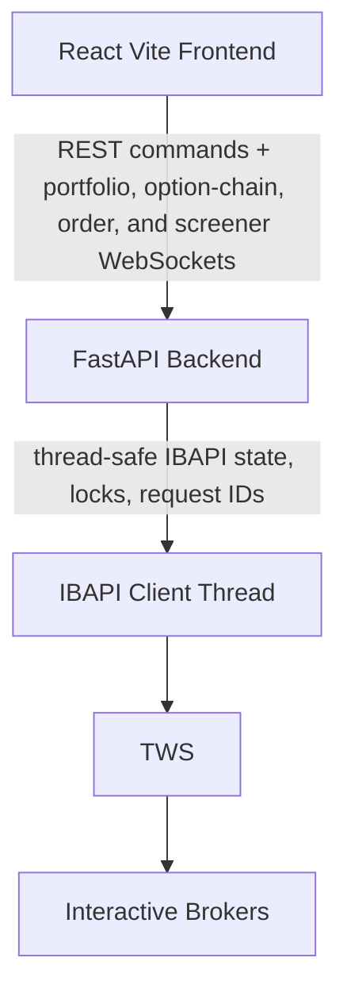

# Investor OS Architecture

## 1. Project Overview

Investor OS is a local trading dashboard for monitoring an Interactive Brokers portfolio, analyzing its market risk, analyzing US equity options, screening cash-secured puts, covered calls, and credit spreads, tracking manual options trades, drafting/transmitting stock or option-strategy orders, maintaining manual stock valuation models, ranking saved valuation models, and watching upcoming earnings dates for a global ticker list.

The application runs as a FastAPI backend connected to TWS through the official `ibapi`, with a React/Vite frontend for the browser UI. It is structured for local development first and still does not include alerts or non-US option support.

---

## 2. Tech Stack

### Backend

* **Python**
* **FastAPI** - REST API and WebSocket server
* **ibapi** - Interactive Brokers TWS integration
* **Pydantic** - request/response validation
* **SQLite** - local completed daily-bar cache, stock-analysis models, daily portfolio NAV and monthly invested amounts, portfolio analysis betas, risk limits, and daily risk snapshots, options trade tracker workspaces, durable screener settings, Earnings Watch state, and order metadata
* **httpx** - Alpha Vantage earnings calendar HTTP client
* **uv** - Python package and environment management

### Frontend

* **React**
* **Vite**
* **TypeScript**
* **Tailwind CSS**
* **shadcn/ui**
* **pnpm** - frontend package manager
* **TradingView Lightweight Charts** - daily candle, Bollinger Band, and RSI charts
* **Recharts** - Portfolio history, Portfolio Analysis risk history, and Options Trade Tracker stats charts

### External Dependency

* **Interactive Brokers TWS**
* **Alpha Vantage** `EARNINGS_CALENDAR` CSV endpoint for Earnings Watch dates

---

## 3. High-Level Architecture



---

## 4. Current Implementation

### Frontend

#### App Shell and Shared UI

* The frontend lives in `frontend/` and is a React/Vite/TypeScript app.
* `frontend/src/App.tsx` is the app shell: providers, sidebar, local page selection, and page-level subscriptions. Page modules are currently eagerly imported into one production bundle. Most pages mount only while active; the Options workspace remains mounted after its first visit, hidden and with its live transports paused while inactive.
* Feature API contracts live under `frontend/src/api/`; shared request/error helpers live in `frontend/src/api/client.ts`. `optionsScreeners.ts` covers durable settings, aggregate scan-state recovery, scan start/cancellation, WebSocket URLs, and quote refresh.
* Shared screener result contracts and two-decimal display formatting live in `frontend/src/features/options-screeners/lib/screenerResults.ts`. Runtime result ordering is owned by the backend for retained top results and by the table shell for user-selected frontend sorts.
* Frontend API helpers accept `AbortSignal` where requests can become obsolete; feature hooks abort stale in-flight requests on cleanup, navigation, or superseding Stock Analysis saves/deletes.
* Shared formatting helpers live in `frontend/src/lib/format.ts`.
* The Portfolio, Options, Options Screener, Options Trade Tracker, Orders, Stock Analysis, and Rank Stocks views use shadcn/ui components for common controls, including buttons, button groups, cards, select dropdowns, tables, checkboxes, dialogs, badges, skeleton loading rows, tooltips, and toast notifications.
* The app is currently forced into shadcn dark mode.
* The sidebar switches between **Portfolio**, **Portfolio Analysis**, **Options**, **Orders**, **CSP Screener**, **CC Screener**, **CS Screener**, **Options Trade Tracker**, **Stock Analysis**, **Earnings Watch**, and **Rank Stocks** without URL routing.
* `App.tsx` owns one session-only selected brokerage account shared by Portfolio, Options, screeners, and Orders. Account choices come only from portfolio summaries and positions, and the first valid account is selected when portfolio data loads.

#### Portfolio View

* Portfolio display-row grouping and sorting helpers live in `frontend/src/features/portfolio/lib/positions.ts`.
* Portfolio UI is split under `frontend/src/features/portfolio/` into the page container, header, account summary card, positions table, table column metadata, and feature hooks.
* The Portfolio view shows an account summary card above the positions table for the selected account.
* Portfolio data arrives through one retained WebSocket: an immediate cached snapshot followed by live updates. REST remains available for explicit refreshes.
* Portfolio table headers are sortable. The default sort is `% Net Liquidity` descending.
* Option legs with the same account, symbol, expiry, right, and currency are grouped into simple vertical spread rows when possible.
* The Portfolio page shows daily closing Net account value with 1M/3M/YTD/1Y/All ranges and a separate editable monthly Amount invested chart. Daily rows retain their report currencies, with separate chart sections at currency transitions and no synthetic observations.
* Portfolio chart values are loaded through `frontend/src/api/portfolioChartValues.ts`, shaped by pure helpers in `frontend/src/features/portfolio/lib/chartValues.ts`, and maintained through a hidden Collapsible editor with explicit Save and Cancel actions.
* Portfolio chart edits preview locally while the editor is open, validate client-side before save, and replace the selected account's saved rows only when Save is clicked.
* Chart state is account-keyed; switching accounts clears drafts, aborts obsolete requests, and shows account-scoped loading state.

#### Portfolio Analysis View

* Portfolio Analysis UI lives under `frontend/src/features/portfolio-analysis/` with `components/`, `hooks/`, and `lib/`, and uses `frontend/src/api/portfolioAnalysis.ts`. It is read-only: it sends no orders and never hedges.
* The page shows one account at a time from the shared selected account. `usePortfolioAnalysis` holds one `/portfolio/analysis/ws` connection; account switches are sent on the open socket and updates for a previous account are dropped. Leaving the page closes the socket, which releases the analysis feeds.
* Sections, top to bottom: the limit-status strip, summary cards, a coverage banner when fallbacks or unsupported positions exist, stress summary cards, the exposure table (underlying, then strategy group, then leg), the stress grid, Realised Risk cards, Risk History charts, the limits editor, and the beta override editor.
* Fallback-sourced values carry an amber indicator whose tooltip names the source. Missing values render `-`. Every stress and margin figure is labelled as an estimate.
* Limits are loaded per account (`useRiskLimits`). The editor is pre-filled with suggested values, but nothing is banded until saved. Limited metrics are coloured green, amber, or red (`lib/limits.ts`).
* Risk History (`useRiskHistory`, `lib/history.ts`) reloads every minute and charts beta-weighted delta, margin used, assignment exposure, and theta on a weekday axis. Missing sessions stay as gaps, intraday snapshots use hollow dots, and saved limits are dashed reference lines.

#### Options View

* Options UI is split under `frontend/src/features/options/` into the page workflow, daily chart, RSI chart, expiration tabs, option-chain table, stock ticket, option-strategy ticket, and focused hooks for chain/chart streams and chart-range synchronization.
* The Options view starts with an explicit ticker search. It loads chart data only after submit, then renders daily candles with Bollinger Bands, a separate RSI panel, expiration tabs, and a selected-expiration chain table.
* The Options workspace mounts on its first visit and remains mounted but hidden during later app-page navigation. This retains the searched ticker, analysis, expiration selection, chain, chart state, and draft strategy legs for the current app session without local storage or URL state; a browser reload still starts from the blank/default workspace.
* The Options view shows a stock trade dialog after analysis loads. Option-chain bid/ask clicks build signed option strategy legs without opening the dialog; a separate Strategy button opens it when legs exist. Duplicate legs merge, zero-net legs disappear, and successful order actions use toast notifications.
* Options cost-basis and option-strike overlays are scoped to the shared selected account. Stock and strategy tickets show that account as read-only context and preview/transmit only for it.
* Out-of-order Options search responses are ignored or aborted so the page reflects the latest submitted ticker.
* While the Options view is active with a selected expiration, the frontend opens one chain WebSocket for the retained ticker and expiration. The WebSocket snapshot initializes the visible chain; REST remains available but is not used for the automatic visible load. Changing ticker or expiration, or hiding the Options workspace, closes the old stream. Returning reconnects one chain stream and one chart stream while keeping the retained data visible.
* Live option-chain row updates are batched per animation frame and merged by strike before updating React state. Backend snapshots are authoritative whenever either usable delta bound changes, so provisional or stale rows are replaced. Retained charts are explicitly refit after the hidden workspace becomes visible.

#### Options Screener Views

* `OptionsScreenersProvider` sits above page selection, loads durable settings and retained scan state, consumes scan WebSocket events, and preserves live jobs, completed snapshots, warnings, and session-only sorting across navigation.
* CSP and CC pages share the CSP/CC ticker list; CS uses a separate ticker list. All three keep independent filters, retained snapshots, warnings, and session-only sorting.
* Results use `@tanstack/react-virtual` with sticky sortable columns; the backend-retained top 500 and total match count are displayed separately. CSP shows Discount %, CC shows Gain %, and CS shows strategy, short/long strikes, net bid/ask, and distance.
* Activating a CSP or CC result refreshes and resolves its contract before opening the shared option-strategy dialog as one short put or one short call. Refresh failures block stale tickets; refreshed filter mismatches remain reviewable with a warning.
* Activating a CS result refreshes both legs through the spread-refresh endpoint, recalculates the net credit, and opens the shared option-strategy dialog as one short leg and one protective long leg. Invalid refreshed net markets block stale tickets; refreshed filter, width, or maximum-loss mismatches remain reviewable with a warning.

#### Options Trade Tracker View

* Options Trade Tracker keeps its page at the feature root, UI modules under `components/`, state orchestration under `hooks/`, and pure calculations/validation/chart shaping under `lib/`.
* The tracker page skips unrelated app-shell renders. Memoized `TradeRow` components receive stable draft objects, row-specific P&L/validation, and stable edit handlers; `TradesTable` memoizes derived lookups and its formatted footer. Notes and dialog edits do not rerender unchanged row controls.
* Trades uses the installed TanStack virtualizer within a capped scroll area, with measured row heights, sticky column headings/footer, and native table row counts/indexes. Only the viewport and a small buffer mount; focused, open-menu, and dragged rows stay mounted with adjacent rows for keyboard traversal. All draft rows still participate in persistence, validation, order, P&L, and Stats.
* Adding a trade reveals and focuses it; validation reveals the first invalid row. Dragging near the table edges scrolls through the full row order. Alt+Up/Down on a drag handle provides keyboard reordering. Performance measurements and verification procedures are recorded under Phase 27 in `docs/implementation_plan.md`.
* The leading `Row` column numbers the full current draft order from 1, including virtualized rows. Add/delete/reorder updates these display-only numbers. Month cells and dropdown options share a fixed palette of tinted labels with readable text in both themes; stored month keys are unchanged.
* `frontend/src/api/optionsTradeTrackers.ts` handles tracker CRUD, detail loading, trade replacement, tracker notes, and global strategy options.
* Users create, select, rename, and delete named trackers. Tracker trade rows and notes are scoped per tracker; strategy options are global.
* Tracker detail and drafts are scoped to the active selection; switching trackers clears drafts and guards obsolete load or mutation responses.
* Trade and notes saves run independently and merge only their confirmed resource. Rename, delete, trade, notes, and global-strategy responses are guarded by active tracker and request generation.
* Trades use explicit save actions. `In Progress` rows may remain partial, while completed rows show inline validation and frontend-derived P&L/footer totals.
* Trade-row P&L and the numeric footer total use the shared sign-color helper: green for positive, red for negative, and neutral for zero. Unavailable row P&L remains blank; each color follows its own current draft value without saving.
* One completed-valid-trade projection supplies row P&L, footer totals, stats, monthly charts, and pie data. Calculations use `jan`-`dec` month keys, uppercase tickers, signed size, positive credit/debit, nullable exit, and `(creditDebit * 100 - exit * 100 - 2) * -size`.
* The Stats tab shows a strategy/month summary table, a monthly chart toggle for stacked-by-strategy versus net P&L, and a strategy execution pie chart based on `abs(size)` counts.
* Monthly strategy totals stack independently above and below zero. Both monthly modes include a zero reference line that anchors the computed numeric domain, including zero-only data. Trades within one strategy/month still net together; Net mode remains the algebraic sum of the strategy contributions.
* Tracker charts use shared `ChartTooltipContent.valueFormatter` to format currency/count values while preserving configured strategy labels and matching color indicators. Monthly tooltips retain their month heading and identify Net P&L; pie tooltips show the strategy and execution count. The shared full-row `formatter` remains available with precedence for existing consumers.
* The pie's feature-local `StrategyExecutionTooltip` retains valid content inside the hidden Recharts wrapper during hover gaps, preserving its measured size and position for the next transition. Retention is scoped to the current chart data, and stale strategy/count payloads are rejected. Recharts continues to control outer visibility, positioning, keyboard interaction, Escape, and reduced motion.
* Pie sectors render directly at their final geometry so their hover targets remain stable from the first interaction. This avoids a missed mouseleave during Recharts' sector entrance animation; tooltip position transitions remain enabled.
* Strategy-summary calculations live inside the mounted `TrackerStats` subtree. Trades retains its synchronous completed-trade projection and explicit saves; input values are not debounced or stored in an additional cache.

#### Orders View

* Orders UI lives under `frontend/src/features/orders/` and renders backend-defined Open and current-day History membership.
* Shared order-entry helpers for numeric parsing and request errors live under `frontend/src/features/orders/lib/`; selected account state is owned by the app shell.
* The Orders WebSocket is owned by active routes that need order state, so inactive pages do not rerender from unrelated order updates.
* The Orders view is scoped to the shared selected account, supports cancelling active orders after confirmation, and edits supported active orders as parent/child groups with quantity, prices, and time in force. Unsupported, unbound, stale, or incomplete groups remain visible with a read-only reason.

#### Stock Analysis View

* Stock Analysis UI lives under `frontend/src/features/stock-analysis/` and provides ticker search plus autosaved bull/base/bear five-year valuation tables.
* Stock Analysis loading/autosave state lives in a feature hook, scenario table rendering lives in a focused component, and row metadata/formatting live in shared feature lib modules.
* Stock Analysis formulas live in `frontend/src/features/stock-analysis/lib/valuationModel.ts`, including derived revenue, net income, EBITDA, OCF, FCF, EPS, valuation-based share-price estimates, CAGR rows, and Year 5 upside/downside multipliers.
* The Stock Analysis view keeps manual numeric edits unformatted while focused, formats on blur/Tab/Enter, and discards active edits on Escape.
* Stock Analysis displays the current stock price from a focused IB-backed lookup. Price endpoints own snapshot writes, while model saves preserve existing snapshots.
* Stock Analysis can delete the active saved ticker after confirmation, then clears the workspace and aborts obsolete loads/autosaves.

#### Rank Stocks View

* Rank Stocks UI lives under `frontend/src/features/rank-stocks/` and loads all saved Stock Analysis models in one request.
* The page renders 15 compact ranking tables: bull, base, and bear scenarios crossed with P/S, P/E, P/EBITDA, P/OCF, and P/FCF.
* Rankings reuse Stock Analysis valuation formulas and sort by saved Year 5 upside/downside multiplier, with missing prices or incomplete inputs shown as `-` and sorted last.
* The page shows saved rankings immediately, then refreshes prices on open and every 15 minutes using single-flight, abortable requests that preserve stale prices on failure.

#### Earnings Watch View

* Earnings Watch UI lives under `frontend/src/features/earnings-watch/` and uses `frontend/src/api/earningsWatch.ts`.
* The page reloads durable backend state on entry, starts with Ticker A-Z sorting, and keeps one row collection for ticker chips and the table so optimistic mutations cannot diverge.
* Users paste or type comma, whitespace, Enter, or multiline ticker batches. Valid tickers are added transactionally by the backend; rejected tokens are shown without blocking valid additions.
* Chips preserve watchlist insertion order and own ticker removal. Rows use a four-column shadcn table: Ticker, Earnings date, Status, Reviewed.
* The page polls every two seconds only while backend metadata reports `refreshing`, stops on terminal states or repeated polling failures, and has no manual refresh button.
* Date display is frontend-only (`Month Day, Year`), while row status is backend-derived as Upcoming, Last known, or No date. Review checkboxes and Clear all reviewed persist immediately with optimistic rollback on failure.

### Backend

#### App Runtime

* The backend lives in `backend/` and exposes a FastAPI app from `app.main:app`.
* `backend/app/main.py` is the composition root for app creation, lifespan setup, dependency assembly, and focused router registration.
* HTTP and WebSocket routes are split by feature, including `backend/app/options_screeners/routes.py` for screener settings and jobs.
* Routes read app-owned services from FastAPI app state. Shared WebSocket send helpers live in `backend/app/websockets.py`, and shared ticker normalization lives in `backend/app/tickers.py`.
* The IBAPI event loop runs in a background thread and is not run inside route handlers.
* The app maintains one IB client connection. IB callback state is grouped by concern inside the callback shell, with locks around shared state mutation and IB request/cancel calls kept outside locks where practical.
* Long-running IB, SQLite, and order mutation paths use app-level concurrency guardrails.
* Option-chain cache misses share a bounded backend executor for daily-bar and metadata fallback work. Resolved option contract identities are cached in memory with single-flight hydration, and a small background prefetch warms selected and nearby expirations after expirations load.
* `/ib/status` returns current IB connection details.
* `/ib/market-data-lines` reports the shared market-data line budget: capacity, lines in use, and waiting demand per group. It is read-only and sends nothing to IB.

#### Portfolio Services

* Pure portfolio row merge and account summary helpers live in `backend/app/portfolio/domain.py`. The thread-safe snapshot cache and centralized refresh service live in `backend/app/portfolio/service.py`.
* `/portfolio` returns the latest in-memory cached Portfolio snapshot immediately.
* One backend refresh service updates account summaries and the Portfolio cache every three seconds, then broadcasts the latest immutable-by-convention snapshot through `/portfolio/ws`.
* Manual Portfolio chart history is stored separately from live IB data in `backend/app/portfolio/chart_values_store.py` and exposed through `GET`/`PUT /portfolio/chart-values?account=...`. PUT transactionally replaces all rows for the selected account.

#### Portfolio Analysis Services

* `backend/app/portfolio_analysis/` holds pure calculations tested without IB: `pricing.py` (Black-Scholes and IV solver), `pairing.py` (strategy groups), `exposure.py` (hybrid Greeks and aggregates), `stress.py` (stress grid), `margin.py` (Reg T estimate and distance to margin call), `realised.py` (NAV-based statistics), and `sessions.py` (New York session keys). IB access stays in `backend/app/ib/`.
* `service.py` builds one analysis per published portfolio snapshot in a worker thread, so the 3 s portfolio refresh is never blocked. Betas are read without IB calls; missing betas and SPY bars are fetched by one background thread, and the flagged 1.0 fallback shows until they arrive.
* `beta.py` regresses up to 252 daily returns against SPY (at least 60) and caches each ticker's beta per US session. Overrides win over computed values.
* `GET /portfolio/analysis?account=` returns one analysis. `WS /portfolio/analysis/ws?account=` streams it and accepts `{"account": ...}` to switch accounts; each connection registers an analysis viewer and releases it on disconnect.
* `GET`/`PUT`/`DELETE /portfolio/analysis/beta-overrides[/{ticker}]` manage beta overrides. `GET`/`PUT /portfolio/analysis/limits/{account}` read and replace an account's risk limits. `GET /portfolio/analysis/history?account=` returns saved daily risk snapshots.
* While a viewer is connected, a risk snapshot is saved at most once a minute, after a one-minute warm-up so the first write has live Greeks. Views with no analysed positions, or with a leg missing a price or Greeks, are not saved.

#### Options Services

* Options analysis orchestration lives in `backend/app/options/client.py`.
* Options client provider construction lives in `backend/app/options/factory.py`.
* Interactive Brokers Options providers live in `backend/app/ib/options.py`.
* Completed daily stock bars are cached in SQLite through `backend/app/options/store.py`.
* Bollinger Band and RSI calculations are pure helpers in `backend/app/options/indicators.py`.
* `/options/{ticker}/analysis` returns chart-ready daily candles, Bollinger Bands, RSI, and the latest underlying price.
* `/options/{ticker}/expirations` returns option expirations after chart analysis loads.
* `/options/{ticker}/chain?expiration=...` returns one selected expiration's resolved call/put contract rows inside the current delta-filtered strike window.
* `/options/{ticker}/chain/ws?expiration=...` streams live authoritative snapshots and row updates for the active ticker, selected expiration, and delta-filtered strike window.
* `/options/{ticker}/chart/ws` streams live underlying candle and indicator updates.

#### Options Screener Services

* `backend/app/options_screeners/store.py` persists the shared CSP/CC ticker list, separate CS ticker list, and independent versioned CSP/CC/CS filters in `data/options_screeners.sqlite3`.
* `domain.py` defines full-precision CSP, CC, and credit-spread calculations, candidate contracts, inclusive filtering, and deterministic ordering. Rounding is deferred to frontend display helpers.
* `manager.py` owns one global in-memory scan job, bounded ticker workers, progress, best-effort cancellation, 30-minute failed/cancelled job retention, live events, and one latest successful snapshot per screener.
* Settings survive backend restarts; jobs, candidates, and completed snapshots intentionally do not.
* `/options-screeners/settings` manages durable settings. `/options-screeners/state`, `/jobs/{id}`, `/snapshots/{screener}`, `/scans/{screener}`, scan cancellation, single-leg quote refresh, spread quote refresh, and `/scans/ws` expose the in-memory lifecycle.
* The scan manager depends on the combined scan-and-refresh service interface. Single-leg and credit-spread leaf services expose only their supported scan and quote-refresh capabilities; the default combined service routes CSP/CC and CS work to the appropriate leaf.
* Screener discovery filters expirations and strikes from `reqSecDefOptParams`, then resolves exact option contracts per strike through the shared contract cache and lookup cap, with lookups running concurrently; scans do not submit throttled strike-wildcard `reqContractDetails` chain requests. A repeated scan on the same market date sends lookups only for strikes it has not resolved yet.
* Single-leg scanning captures one underlying price per ticker, evaluates all standard OTM puts for CSP or OTM calls for CC in the inclusive New York DTE range, deduplicates equivalent contracts, rejects invalid markets, and retains the globally sorted top 500 with the pre-cap match count.
* CS scanning builds exact-width put and call credit spreads from refreshed same-expiration chains, applies delta filters to the short leg, requires positive executable net-credit markets, and ranks by annualized return on maximum loss.
* CSP return uses premium divided by strike and discount from underlying to strike. CC return uses premium divided by captured underlying price and gain from underlying to strike. The screener does not check cash, margin, owned shares, or whether a later order would be covered.

#### Options Trade Tracker Services

* `backend/app/options_trade_tracker/store.py` persists trackers, ordered trade rows, notes, and global strategy options in `data/options_trade_trackers.sqlite3`.
* `/options-trade-trackers` supports list/create, detail, rename, delete, trade replacement, notes updates, and global strategy-option updates.
* Tracker deletion cascades tracker rows and notes while preserving global strategies.
* Trade row identity is `(tracker_id, id)`.
* Backend validation permits nullable partial drafts, requires positive strike/credit-debit and non-negative exit for both statuses, and rejects zero-size completed rows. Failed replacements roll back and return HTTP 422.

#### Stock Analysis Services

* Stock Analysis model persistence lives in `backend/app/stock_analysis/store.py`.
* `/stock-analysis/{ticker}` gets or saves the manual valuation model payload for one ticker.
* `/stock-analysis` lists all saved models ordered by ticker.
* `DELETE /stock-analysis/{ticker}` idempotently removes the saved model and its current-price snapshot.
* `/stock-analysis/{ticker}/current-price` uses a focused recent-bar lookup and persists successful snapshots without running full options analysis.
* `/stock-analysis/current-prices/refresh` refreshes saved current-price snapshots best-effort, preserving previous prices when IB price lookup fails.
* Local SQLite stores use Python's standard `sqlite3` module directly; the backend does not include an ORM or migration dependency while these stores remain local runtime caches/models.

#### Earnings Watch Services

* Earnings Watch persistence lives in `backend/app/earnings_watch/store.py` using `data/earnings_watch.sqlite3`.
* The store persists global watchlist rows, reviewed booleans, saved nearest-date snapshots, a normalized provider cache, and refresh metadata. It does not scope data by brokerage account.
* `backend/app/earnings_watch/provider.py` fetches Alpha Vantage `EARNINGS_CALENDAR` once per refresh with fixed `horizon=3month`, no `symbol`, and CSV validation. The API key is read only from `ALPHA_VANTAGE_API_KEY`.
* `backend/app/earnings_watch/service.py` owns lazy daily refresh, single-flight provider calls, one-hour persisted failure cooldowns, and serialized refresh/manual mutations.
* Successful refreshes replace the normalized provider cache and update currently watched tickers that appear in the response without changing reviewed state. Missing or past saved dates remain visible as `last_known`.
* `/earnings-watch` returns saved rows immediately with `Cache-Control: no-store` and starts a due refresh in the background. Focused mutation endpoints add ticker batches, remove one ticker, update one reviewed boolean, and clear all reviewed booleans.

#### Orders Services

* Order preview, submission, cancellation, amendment, reconciliation, and status fan-out live in `backend/app/orders/service.py`.
* Durable order records live in `backend/app/orders/store.py` using `data/orders.sqlite3`; the store preserves preview/request metadata, IB identifiers, editable status, fills, execution/completion metadata, and reconciliation state across backend restarts.
* The order service depends on an explicit IB order interface: connected state, IB order IDs, placement, cancellation, open-order/execution/completed-order reconciliation, contract lookup, and submitted-order rejection callbacks.
* `/orders/preview` returns confirmation-ready stock or option-strategy order details.
* `/orders/transmit` submits confirmed stock or option-strategy orders to IB.
* `/orders/{order_id}` amends editable active orders by reusing original IB order IDs. Linked parent/child orders are amended together in deterministic order, while stock, single-option, and combo strategy quantity semantics preserve fills and combo leg ratios.
* `/orders/{order_id}/cancel` cancels tracked active orders.
* `/orders` and `/orders/ws` include backend-computed `is_open` and `is_current_day_history` fields. History membership uses execution or completion timestamps when available, not browser-local dates.
* Reconciled IB rows expose backend-built summaries plus durable ID details so negative/manual API order IDs are metadata, not the main row label.
* Reconstructed IB `BAG` open orders preserve signed combo limit prices, including negative credit prices reported by IB.
* `/orders/ws` streams order snapshots and submitted, working, partially filled, stale, filled, cancelled, rejected, pending, confirmed, execution, and completed-order updates through bounded subscriber queues.

### Portfolio Data

Portfolio rows are assembled from cached IB callbacks and include:

* instrument identity from IB contract fields
* position quantity and average cost from one long-lived `reqPositions` subscription
* last price and previous close from `reqMktData`
* daily P&L, unrealized P&L, realized P&L, and market value from `reqPnLSingle`
* net liquidation from `reqAccountSummary`

The account summary card is populated from `reqAccountSummary` for net liquidation, market value, margin, excess liquidity, and buying power, plus `reqPnL` for account daily P&L and unrealized P&L. It also shows SGD, USD, and base-currency cash totals from ledger `TotalCashBalance` values requested through `$LEDGER:SGD`, `$LEDGER:USD`, and `$LEDGER`. Ledger requests run sequentially to stay within IB's active account-summary subscription limit; the displayed base total is IB-provided rather than calculated by adding currencies. Market-data and P&L streams are reused and stale subscriptions are cancelled when positions or accounts disappear.

Derived display values are kept in the app where IBAPI does not expose an exact field: cost basis, displayed average price, `Change %`, `P&L %`, `Unrealized P&L %`, `% Net Liquidity`, account `Equity %`, and grouped spread rows. Missing IB values remain empty rather than being replaced with fallback estimates.

Manual Portfolio chart history is user-authored and is not inferred from live IB summaries. Rows are stored per account and month (`YYYY-MM`) with cumulative `amount_invested` values and update metadata. Startup migration removes the obsolete `portfolio_value` column and rows containing only that value, preserving every invested amount and its metadata. The dedicated SQLite database is `data/portfolio_chart_values.sqlite3`.

Daily NAV and sync metadata use separate tables in the same database. `portfolio/nav_store.py` stores exact decimals by account/date, rejects currency conflicts, and prioritizes Flex corrections. `flex.py` and `nav_sync.py` fetch completed reports at startup and hourly with bounded retries and catch-up. Saved history and account discovery remain available without TWS. The chart polls every 30 seconds, isolates account responses, and separates currency periods. Monthly Amount invested remains independently editable.

### Portfolio Analysis Data

Portfolio Analysis covers US stocks, ETFs, and standard 100-multiplier equity options. Other instruments are listed as unsupported and left out of totals. Values are in USD; non-USD positions are converted at IB's ledger exchange rate and flagged.

Greeks come from IB's `tickOptionComputation` on the portfolio market-data requests. Missing Greeks are filled from Black-Scholes (`Settings.risk_free_rate`, no dividends) at IB's IV, or at an IV solved from the option's last, close, or IB position mark. A price at or below the zero-volatility model value (a deep ITM call under the European bound) solves to the minimum IV. Coverage counts report fallback Greeks, fallback betas, and unsupported positions.

Short option legs are paired per account and underlying: same-expiry verticals first, then held shares (covered calls), then a later or same-expiry long (PMCC and its put mirror), otherwise naked. This grouping is separate from the Portfolio tab's Bull/Bear display grouping.

The stress grid moves each underlying by beta x SPY move (-30% to +10%, floored at -95%) and IV by 0 to +100% relative, repricing options with Black-Scholes. A strategy group with a leg that has no price or IV is left out of the grid whole. Margin uses Reg T maintenance rules per group, scaled up by `max(1, MaintMarginReq / model margin)`. Distance to margin call is where stressed excess liquidity reaches zero along the realistic path.

`data/portfolio_analysis.sqlite3` holds `beta_cache`, `beta_overrides`, per-account risk limits, and `risk_snapshots`. Snapshots are keyed by account and US session: a view during market hours is saved as `intraday`, and a view outside market hours as `post_close` for the last completed session, which always wins over `intraday`. Gaps are not filled. Daily bars for a beta that miss SPY's latest session or more than 5 of SPY's dates (a timed-out or partial chunk) are refetched after 60 s, up to three times a session, before they are cached. Realised volatility, drawdown, and beta are computed from the Flex daily NAV history and include deposits and withdrawals as returns.

### Options Data

Options analysis qualifies US equity underlyings as `STK`, `USD`, `SMART`. Completed daily candles are cached in SQLite by normalized ticker and trading date; the current trading day is returned separately and is not finalized into SQLite. Bollinger Bands use 20-period SMA with 2 standard deviations, and RSI uses 14-period Wilder smoothing.

Option-chain rows are built from resolved IB option contracts for the requested expiration, not from metadata-only strikes. Contract resolution starts from every positive, deduplicated metadata strike. One broad `reqContractDetails` request per expiration covers calls and puts together, because IB answers broad requests one at a time and slowly for expirations it has not loaded recently. If it times out, the backend remembers that for the market day and falls back to exact per-strike lookups for both rights concurrently, limited to strikes near the money that can be streamed or displayed. Broad and exact requests share a 30-second aggregate hydration deadline; a chain WebSocket cancellation interrupts an active contract-detail wait.

Resolved contracts are cached in memory per ticker, expiration, right, and strike, including known-invalid strikes, until the US market date changes. The chain and the screeners share this cache, and concurrent loads share one in-flight hydration. Timed-out or unattempted strikes retry on a later load; explicitly invalid or unavailable strikes are not re-requested that day. The cache is keyed on the expiration string as given, so callers use ISO dates. Selected and nearby expirations are prefetched best-effort once expirations load. Cache entries are process-local and clear on backend restart.

All contract-detail requests share one app-wide cap of 16 outstanding lookups; IB rejects or queues more across every client. A slot is held until IB answers or errors. Prefetch lookups are background work: they use at most 4 slots and wait while any foreground lookup waits, and they become foreground when a user opens the chain they are hydrating. Single lookups a user or scan is blocked on (a ticker's options metadata, a chart contract, a quote refresh) are urgent and take the next free slot ahead of waiting bulk lookups. Screener exact lookups and the metadata stock lookup may queue up to 60 seconds for a slot, then get the full IB timeout once sent, so local queueing behind other tickers is never reported as an IB timeout. The options metadata cache locks per ticker, so one slow fetch does not hold up other tickers. Market-data requests and lookups share a client-side message-rate limiter below IB's 50 messages per second.

Market-data lines come from one shared budget (`max_market_data_lines` less `market_data_line_reserve`). Groups are granted in priority order: portfolio, charts, chain streams, quote refreshes, then screener batches. While Portfolio Analysis is open, position quotes stay subscribed and the stocks underlying option positions that are not held are quoted too, all in the portfolio group; the last viewer leaving releases the underlying lines. Unmet demand from a higher group blocks grants to lower groups. Screener batch size shrinks or waits for free lines. IB error 101 on a request is recorded against it and surfaced as a scan warning or chain message instead of a silent exclusion.

Screener quotes run through a rolling window of up to 40 lines per ticker. Each contract frees its line when its own quote is usable: when it has bid, ask, and delta, or when it has delta and at least one of bid or ask and no new field has arrived for 300 ms. Otherwise it frees its line at the 4-second maximum, where contracts that never quote end. Freed lines go to the next contract without waiting, unless a higher-priority group is waiting for lines, in which case the window shrinks. REST chain quote batches and single-quote refreshes apply the same rule to the batch as a whole. Each subscription group has its own wakeup signal.

Displayed rows are trimmed to the first put and last call whose absolute delta is greater than `0.095` once both usable bounds exist. Before Greeks arrive, quoted resolved contracts remain visible. Live quote changes are coalesced per IB callback batch; whenever either delta bound changes, the backend sends an authoritative snapshot that replaces provisional or stale rows. Quote-only batches keep the row-update path. Rows place calls on the left, strike in the middle, and puts on the right. `mid` is derived from bid/ask when both exist; breakeven is `strike + ask` for calls and `strike - ask` for puts. Option-chain and screener delta, IV, gamma, theta, and model price come only from IB's model option computation (tick 13, delayed 83); bid, ask, and last computations solve IV from that one price, so a wide quote skews their delta, and they are ignored. Missing IB values remain missing.

Live option-chain streams resolve the same selected expiration from the full normalized metadata strike set as the snapshot endpoint, then stream calls and puts for the `max_option_chain_stream_strikes` strikes nearest the money. The remaining hydrated strikes are quoted by rotation through `option_chain_rotation_lines` reserved lines. Each batch is subscribed, read once it completes or reaches its maximum wait, then cancelled. The first pass works outward from the live window; later passes refresh strikes inside or next to the delta bounds, plus one beyond each bound, so the displayed range can widen. The live window recenters once the at-the-money strike is three or more strikes from its center. For SPY, a first pass over 48 outer strikes took about 28 s and later passes about 5 s, so rotated rows carry no staleness indicator. The backend subscribes to IB option market data for these strikes, isolates quote state by IB request ID, sends snapshots plus row updates as ticks arrive, and cancels only that stream's market-data subscriptions when the WebSocket disconnects or the frontend switches ticker or expiration. A short in-memory quote cache can seed a newly opened stream with recently seen display quotes while fresh live subscriptions continue. Quote and Greek availability depends on the user's IB market-data subscriptions and delayed-data settings.

Live chart streams load the completed historical window once per stream, then update the active underlying candle and latest Bollinger Band and RSI points without persisting the current trading day's temporary candle.

### Options Trade Tracker Data

Options trade tracker data is manually authored and stored in `data/options_trade_trackers.sqlite3`. Trackers own their trade rows and notes; strategy options are global and survive tracker deletion. Trade row ids are stable within each tracker, and partial `In Progress` drafts retain nullable fields. The frontend derives P&L and stats from completed valid, non-zero-size rows only.

### Stock Analysis Data

Stock Analysis stores one manual valuation model per ticker in SQLite at `data/stock_analysis.sqlite3`. The saved row contains scenario inputs, first forecast year, and a nullable current-price snapshot; formula outputs remain frontend-derived so the display can be recalculated consistently.

The current stock price uses a focused recent-bar provider instead of full options analysis. It is read-only in the valuation page, persists through price endpoints independently of model saves, and drives CAGR, Year 5 multiplier, and Rank Stocks calculations.

### Earnings Watch Data

Earnings Watch data is global and stored in `data/earnings_watch.sqlite3`. Saved rows retain their last known earnings date until a later successful provider refresh confirms a newer date. Provider errors store only safe categories such as `not_configured`, `rate_limited`, `network`, `timeout`, and `invalid_response`; raw provider bodies and API keys are not stored or exposed.

### Order Entry

Order entry uses REST for preview/transmit/amend/cancel commands and `/orders/ws` for authoritative status updates. Every order uses the shared selected account. Stock tickets support market or limit buys and sells by whole-share quantity, time in force, and editable active limit orders. Sell tickets prevent selling more shares than the selected account owns.

Option strategy tickets are built from chain bid/ask clicks and opened through the Strategy button. Ask clicks create buy legs, bid clicks create sell legs, each leg shows its bid/ask quote context, signed quantities are editable, optional take-profit and stop-loss exits create linked bracket orders, and multi-leg strategies are submitted as IB `BAG` combo orders after resolving option contract IDs. Single-leg option credit orders preserve signed preview prices but submit positive IB limit prices. IB remains authoritative for order state and rejection messages.

CSP, CC, and CS result tickets reuse the same dialog and preview/transmit flow. They display refreshed midpoint or net midpoint credit as positive, preserve the signed internal credit convention, and may open without a selected account while keeping preview blocked. CS tickets refresh both legs and prefill one short leg plus one protective long leg. CC tickets do not compare quantity against owned shares; IB remains authoritative for coverage validation and rejection.

On startup the backend loads durable order records, enables manual TWS order binding through client ID `0`, then uses one client-0 open-order snapshot plus executions and completed orders for reconciliation. Open-order reconciliation treats a completed snapshot as authoritative for Open membership: absent active records are kept durably but marked non-open/stale unless execution or completed-order data supplies a terminal status. Executions and completed-order callbacks reconcile by permanent ID before local order ID, preserve real execution/completion times for History, and can create read-only rows when IB reports trades or terminal orders that were not previously tracked. Bound external orders, including negative nonzero manual API order IDs, can be amended when enough IB open-order detail is available; API order ID `0` remains read-only.

---

## 5. Local Development Setup

Start TWS.

### Terminal 1

Start FastAPI:

```bash
cd backend
uv run uvicorn app.main:app --host 127.0.0.1 --port 8000
```

Avoid `--reload` while working with IBAPI unless needed, because reload workers can create extra IB client sessions.

### Terminal 2

Start frontend:

```bash
cd frontend
pnpm dev
```

---

## 6. Runtime Settings

The current backend settings are fixed local Python defaults in `backend/app/config.py` for local development, except `alpha_vantage_api_key`, which is read from `.env` or `../.env`.

```text
Settings.ib_host = "127.0.0.1"
Settings.ib_port = 7496
Settings.ib_client_id = 0
Settings.options_database_path = "data/options.sqlite3"
Settings.options_screeners_database_path = "data/options_screeners.sqlite3"
Settings.orders_database_path = "data/orders.sqlite3"
Settings.stock_analysis_database_path = "data/stock_analysis.sqlite3"
Settings.portfolio_chart_values_database_path = "data/portfolio_chart_values.sqlite3"
Settings.options_trade_trackers_database_path = "data/options_trade_trackers.sqlite3"
Settings.earnings_watch_database_path = "data/earnings_watch.sqlite3"
Settings.portfolio_analysis_database_path = "data/portfolio_analysis.sqlite3"
Settings.alpha_vantage_api_key = ALPHA_VANTAGE_API_KEY from .env
Settings.ib_request_queue_timeout_seconds = 0.25
Settings.max_concurrent_options_analysis = 2
Settings.max_concurrent_option_chains = 2
Settings.max_concurrent_order_writes = 1
Settings.max_concurrent_stock_analysis_reads = 4
Settings.max_concurrent_stock_analysis_writes = 2
Settings.max_concurrent_options_screener_tickers = 4
Settings.options_screener_job_retention_minutes = 30
Settings.options_screener_subscriber_queue_size = 64
Settings.option_chain_context_workers = 2
Settings.max_option_chain_strikes = 80
Settings.max_option_chain_stream_strikes = 32
Settings.max_market_data_lines = 100
Settings.market_data_line_reserve = 5
Settings.option_chain_rotation_lines = 10
Settings.order_subscriber_queue_size = 32
Settings.risk_free_rate = 0.04
```

The frontend reads `VITE_API_BASE_URL` and defaults to `http://127.0.0.1:8000` when it is not set. API ticker paths are normalized and encoded through the shared frontend API helper. WebSocket URLs are derived from the same base URL by replacing `http` with `ws`.

---

## 7. Key Implementation Rules

1. Do not call `ibapi.run()` directly inside a FastAPI route.
2. Run the IBAPI event loop in a background thread.
3. Keep one IBKR client connection for the app.
4. Use request IDs to track IBKR requests.
5. Use thread-safe queues or locks when sharing data between IBAPI callbacks and FastAPI.
6. Use REST for commands and WebSockets for live updates.
7. Use paper trading during development.
8. Do not enable multi-worker FastAPI until the IBKR connection architecture is redesigned.
9. Keep the MVP local-first and simple.
10. Avoid duplicate IB client IDs; TWS allows only one active API session per client ID.
11. Market data availability depends on the user's IB subscriptions and delayed-data settings.

